# Brit ERD v4 — MVP 45 Tables

> 기준: PostgreSQL 17 + NestJS  
> 설계 방향: Brit ERD v3의 41개 핵심 구조를 유지하면서, 1~50 정책 결정과 최신 MVP 단순화 원칙을 반영한다.

## 0. v4 핵심 원칙

1. 회원가입 시 외부 본인인증을 사용하지 않고, 사용자 승인과 계좌 승인을 분리한다.
2. 사용자 Coin과 업체 법인 Coin을 분리하고 각각 현재 잔액 집계와 불변 원장을 둔다.
3. 사용자 Coin은 Wallet / Lot / Ledger 3계층으로 관리한다.
4. Brit 직접 구매 Coin은 기본 판매 불가, PARTNER_REDEEM / PARTNER_ADMIN_GRANT Coin은 판매 가능하다.
5. 완료된 P2P·CHARGE·REDEEM·정산 데이터는 직접 수정·삭제하지 않는다.
6. 관리자 보정은 원장을 새로 추가하고 audit_logs로 추적한다.
7. 업체 Coin 잔액은 음수를 허용한다. 별도 credit_limit·risk_control은 MVP에 두지 않는다.
8. 외부 API TIMEOUT은 실패가 아니라 RECONCILIATION_REQUIRED로 처리한다.
9. 관리자는 초기 MVP에서 대부분의 운영 데이터를 조회할 수 있다. 전체 수익과 주민번호 전체 조회만 별도 권한 컬럼으로 제한한다.
10. 배너·광고·자동 신용등급·복잡한 Data Scope는 MVP에서 제외한다.
11. 정산 기본값은 주 1회, 지급기한 3영업일, 건별 수수료 원단위 절사, 부분 입금 허용이다.
12. 분쟁은 trade_disputes + trade_dispute_actions 2개 테이블로 단순화한다.

---

# 1. 전체 45개 테이블

| No | 영역 | Table | 핵심 책임 |
|---:|---|---|---|
| 1 | 사용자 | users | 로그인 자격과 현재 가입 상태 |
| 2 | 사용자 | user_profiles | 실명·주민번호·통신사·PIN |
| 3 | 사용자 | user_roles | USER / ADMIN / SYS_ADMIN 역할 |
| 4 | 사용자 | admin_profiles | 관리자 등급·리더·민감정보 권한 |
| 5 | 사용자 | user_consents | 약관 동의 버전 |
| 6 | 사용자 | user_sessions | Refresh 세션 |
| 7 | 계좌 | banks | 은행 기준정보 |
| 8 | 계좌 | user_bank_accounts | 계좌 등록·변경 이력 |
| 9 | 심사 | user_approval_reviews | 사용자 승인·반려 이력 |
| 10 | 심사 | user_bank_account_reviews | 계좌 승인·반려 이력 |
| 11 | 사용자 Coin | user_coin_wallets | 사용자 현재 Coin 집계 |
| 12 | 사용자 Coin | user_coin_lots | Coin 출처·판매가능성·잔량 |
| 13 | 사용자 Coin | coin_ledger_entries | 사용자 Coin 불변 원장 |
| 14 | 업체 | partners | 제휴 업체 루트 |
| 15 | 업체 | partner_members | 업체 담당자 |
| 16 | 업체 SDK | partner_clients | SDK/API Client |
| 17 | 업체 SDK | partner_client_secrets | Client/Webhook Secret |
| 18 | 업체 SDK | partner_client_scopes | Client 호출 권한 |
| 19 | 업체 SDK | partner_client_origins | 허용 Origin |
| 20 | 업체 연결 | partner_link_sessions | SDK 일회성 연결 세션 |
| 21 | 업체 연결 | user_partner_links | Brit 사용자↔업체 사용자 영구 연결 |
| 22 | 업체 전환 | partner_assets | 업체 포인트/자산 종류 |
| 23 | 업체 전환 | partner_exchanges | CHARGE / REDEEM 루트 |
| 24 | 업체 전환 | partner_exchange_coin_lots | CHARGE 사용 Lot 연결 |
| 25 | 업체 전환 | partner_exchange_events | 전환 상태 이력 |
| 26 | 업체 전환 | partner_exchange_attempts | 외부 API 호출/조회 이력 |
| 27 | 수수료 | partner_fee_policies | 업체별 수수료·정산 정책 |
| 28 | 수수료 | partner_fee_accruals | 완료 전환 건별 수수료 |
| 29 | 정산 | partner_settlements | 기간별 업체 정산서 |
| 30 | 정산 | partner_settlement_items | 정산서 포함 수수료 근거 |
| 31 | 정산 | partner_settlement_payments | 부분 입금 이력 |
| 32 | 업체 Coin | partner_coin_wallets | 업체 Coin 현재 잔액, 음수 허용 |
| 33 | 업체 Coin | partner_coin_ledger_entries | 업체 Coin 불변 원장 |
| 34 | 업체 Coin | partner_coin_grants | 업체→업체 관리자 Coin 지급 |
| 35 | P2P | matching_policies | 매칭/시간/분할 정책 |
| 36 | P2P | buy_orders | 구매 주문 |
| 37 | P2P | sell_orders | 판매 주문 |
| 38 | P2P | sell_order_coin_lots | 판매 주문 Lot 잠금 |
| 39 | P2P | matching_attempts | 매칭 시도 로그 |
| 40 | P2P | trades | 실제 거래 |
| 41 | P2P | trade_events | 거래 상태·행동 이력 |
| 42 | P2P | trade_coin_lots | 거래에 배정된 Coin Lot |
| 43 | 분쟁 | trade_disputes | 분쟁 현재 상태 |
| 44 | 분쟁 | trade_dispute_actions | 채팅·증빙·배정·강제처리 이력 |
| 45 | 운영 | audit_logs | 민감 관리자 행동 감사 로그 |

---

# 2. 핵심 관계도

```mermaid
erDiagram
    USERS ||--|| USER_PROFILES : has
    USERS ||--o{ USER_ROLES : granted
    USERS ||--o| ADMIN_PROFILES : admin
    USERS ||--o{ USER_CONSENTS : agrees
    USERS ||--o{ USER_SESSIONS : logs_in
    USERS ||--o{ USER_APPROVAL_REVIEWS : reviewed

    BANKS ||--o{ USER_BANK_ACCOUNTS : identifies
    USERS ||--o{ USER_BANK_ACCOUNTS : owns
    USER_BANK_ACCOUNTS ||--o{ USER_BANK_ACCOUNT_REVIEWS : reviewed
    USER_BANK_ACCOUNTS o|--o{ USER_BANK_ACCOUNTS : replaces

    USERS ||--|| USER_COIN_WALLETS : owns
    USERS ||--o{ USER_COIN_LOTS : owns
    USERS ||--o{ COIN_LEDGER_ENTRIES : ledger
    USER_COIN_LOTS o|--o{ COIN_LEDGER_ENTRIES : references

    PARTNERS ||--o{ PARTNER_MEMBERS : has
    USERS ||--o{ PARTNER_MEMBERS : assigned
    PARTNERS ||--o{ PARTNER_CLIENTS : issues
    PARTNER_CLIENTS ||--o{ PARTNER_CLIENT_SECRETS : authenticates
    PARTNER_CLIENTS ||--o{ PARTNER_CLIENT_SCOPES : authorizes
    PARTNER_CLIENTS ||--o{ PARTNER_CLIENT_ORIGINS : allows

    PARTNER_CLIENTS ||--o{ PARTNER_LINK_SESSIONS : starts
    USERS o|--o{ PARTNER_LINK_SESSIONS : authenticates
    USERS ||--o{ USER_PARTNER_LINKS : links
    PARTNERS ||--o{ USER_PARTNER_LINKS : links

    PARTNERS ||--o{ PARTNER_ASSETS : provides
    USER_PARTNER_LINKS ||--o{ PARTNER_EXCHANGES : requests
    PARTNER_ASSETS ||--o{ PARTNER_EXCHANGES : converts
    PARTNER_CLIENTS o|--o{ PARTNER_EXCHANGES : creates
    PARTNER_EXCHANGES ||--o{ PARTNER_EXCHANGE_COIN_LOTS : allocates
    USER_COIN_LOTS ||--o{ PARTNER_EXCHANGE_COIN_LOTS : consumes
    PARTNER_EXCHANGES ||--o{ PARTNER_EXCHANGE_EVENTS : records
    PARTNER_EXCHANGES ||--o{ PARTNER_EXCHANGE_ATTEMPTS : communicates

    PARTNERS ||--o{ PARTNER_FEE_POLICIES : configures
    PARTNER_EXCHANGES ||--o| PARTNER_FEE_ACCRUALS : accrues
    PARTNER_FEE_POLICIES ||--o{ PARTNER_FEE_ACCRUALS : snapshots
    PARTNERS ||--o{ PARTNER_SETTLEMENTS : settles
    PARTNER_SETTLEMENTS ||--o{ PARTNER_SETTLEMENT_ITEMS : contains
    PARTNER_SETTLEMENTS ||--o{ PARTNER_SETTLEMENT_PAYMENTS : receives
    PARTNER_FEE_ACCRUALS ||--o| PARTNER_SETTLEMENT_ITEMS : included

    PARTNERS ||--|| PARTNER_COIN_WALLETS : owns
    PARTNERS ||--o{ PARTNER_COIN_LEDGER_ENTRIES : ledger
    PARTNERS ||--o{ PARTNER_COIN_GRANTS : distributes
    PARTNER_MEMBERS ||--o{ PARTNER_COIN_GRANTS : receives
    PARTNER_COIN_GRANTS ||--o| USER_COIN_LOTS : creates

    MATCHING_POLICIES ||--o{ SELL_ORDERS : snapshots
    USERS ||--o{ BUY_ORDERS : buys
    USERS ||--o{ SELL_ORDERS : sells
    SELL_ORDERS ||--o{ SELL_ORDER_COIN_LOTS : locks
    USER_COIN_LOTS ||--o{ SELL_ORDER_COIN_LOTS : allocated
    BUY_ORDERS ||--o{ MATCHING_ATTEMPTS : attempts
    SELL_ORDERS o|--o{ MATCHING_ATTEMPTS : candidate

    BUY_ORDERS ||--o{ TRADES : matches
    SELL_ORDERS ||--o{ TRADES : splits
    USER_BANK_ACCOUNTS ||--o{ TRADES : snapshot
    TRADES ||--o{ TRADE_EVENTS : records
    TRADES ||--o{ TRADE_COIN_LOTS : allocates
    USER_COIN_LOTS ||--o{ TRADE_COIN_LOTS : transfers
    TRADES ||--o{ TRADE_DISPUTES : disputed
    TRADE_DISPUTES ||--o{ TRADE_DISPUTE_ACTIONS : actions

    USERS o|--o{ AUDIT_LOGS : acts
```



---

# 3. 사용자·인증

## 3.1 users

사용자 루트. 가입 승인과 로그인 자격의 현재 상태를 관리한다.

| 컬럼 | 타입 | 설명 |
|---|---|---|
| id | UUID PK | 사용자 ID |
| login_id | VARCHAR(30) UNIQUE | 로그인 ID |
| password_hash | VARCHAR(255) | 비밀번호 Hash |
| phone_e164 | VARCHAR(20) UNIQUE | 휴대전화 |
| status | user_status | PENDING/ACTIVE/SUSPENDED/WITHDRAWN/REJECTED |
| registration_submitted_at | TIMESTAMPTZ | 가입 제출 |
| approved_at | TIMESTAMPTZ NULL | 사용자 승인 시각 |
| approved_by_user_id | UUID FK users NULL | 승인 관리자 |
| rejected_at | TIMESTAMPTZ NULL | 반려 시각 |
| rejection_reason | VARCHAR(500) NULL | 반려 이유 |
| last_login_at | TIMESTAMPTZ NULL | 최종 로그인 |
| password_changed_at | TIMESTAMPTZ | 비밀번호 변경 |
| withdrawn_at | TIMESTAMPTZ NULL | 탈퇴 |
| created_at | TIMESTAMPTZ | 생성 |
| updated_at | TIMESTAMPTZ | 수정 |

핵심: `users.status=ACTIVE`와 계좌 ACTIVE는 서로 독립적이다.

## 3.2 user_profiles

가입 시 제출한 상세 개인정보.

| 컬럼 | 타입 | 설명 |
|---|---|---|
| user_id | UUID PK/FK | 사용자 |
| name | VARCHAR(50) | 실명 |
| resident_registration_number | CHAR(14) UNIQUE | 주민번호 원본 `000000-0000000` |
| birth_date | DATE | 생년월일 |
| gender_code | CHAR(1) | M/F |
| mobile_carrier | VARCHAR(20) | 통신사 |
| nickname | VARCHAR(30) UNIQUE NULL | 닉네임 |
| pin_hash | VARCHAR(255) | 거래 PIN Hash |
| pin_failed_count | SMALLINT | 실패 횟수 |
| pin_locked_until | TIMESTAMPTZ NULL | PIN 잠금 |
| pin_changed_at | TIMESTAMPTZ | 변경 시각 |
| profile_image_path | TEXT NULL | 프로필 이미지 |
| created_at | TIMESTAMPTZ | 생성 |
| updated_at | TIMESTAMPTZ | 수정 |

MVP에서는 주민번호 Hash/Masked 별도 저장 없음. 기본 API 응답은 서버에서 마스킹한다.

## 3.3 user_roles

단순 전역 역할.

| 컬럼 | 타입 | 설명 |
|---|---|---|
| user_id | UUID FK | 사용자 |
| role | user_role | USER/ADMIN/SYS_ADMIN |
| status | role_grant_status | ACTIVE/REVOKED |
| granted_by_user_id | UUID FK NULL | 부여자 |
| granted_at | TIMESTAMPTZ | 부여 |
| revoked_at | TIMESTAMPTZ NULL | 회수 |

PK: `(user_id, role)`

## 3.4 admin_profiles

ADMIN/SYS_ADMIN의 운영 속성을 간단하게 관리한다.

| 컬럼 | 타입 | 설명 |
|---|---|---|
| user_id | UUID PK/FK | 관리자 |
| admin_level | SMALLINT | 1/2/3 |
| is_leader | BOOLEAN | 리더 여부 |
| can_view_revenue | BOOLEAN | Brit 전체 수익 조회 |
| can_view_full_identity | BOOLEAN | 주민번호 전체 조회 |
| is_active | BOOLEAN | 관리자 업무 가능 |
| created_at | TIMESTAMPTZ | 생성 |
| updated_at | TIMESTAMPTZ | 수정 |

초기에는 관리자 전체가 사용자·거래·분쟁·업체 운영 데이터를 조회 가능. 민감정보만 Boolean으로 제한한다.

## 3.5 user_consents

| 컬럼 | 타입 |
|---|---|
| id | UUID PK |
| user_id | UUID FK |
| consent_type | VARCHAR(50) |
| document_version | VARCHAR(50) |
| agreed | BOOLEAN |
| agreed_at | TIMESTAMPTZ |
| ip_address | INET NULL |
| created_at | TIMESTAMPTZ |

## 3.6 user_sessions

| 컬럼 | 타입 |
|---|---|
| id | UUID PK |
| user_id | UUID FK |
| refresh_token_hash | VARCHAR(255) UNIQUE |
| status | session_status |
| user_agent | TEXT NULL |
| ip_address | INET NULL |
| expires_at | TIMESTAMPTZ |
| revoked_at | TIMESTAMPTZ NULL |
| created_at | TIMESTAMPTZ |
| last_used_at | TIMESTAMPTZ NULL |

---

# 4. 계좌·심사

## 4.1 banks

은행 코드/이름/아이콘/점검정보.

주요 컬럼:
`id, code, name, icon_key, svg_filename, daily_maintenance_start, daily_maintenance_end, regular_maintenance_rule, maintenance_note, sort_order, is_active, created_at, updated_at`

## 4.2 user_bank_accounts

계좌번호는 덮어쓰지 않고 변경 때 새 행을 생성한다.

| 컬럼 | 타입 |
|---|---|
| id | UUID PK |
| user_id | UUID FK |
| bank_id | UUID FK |
| account_number | VARCHAR(100) |
| holder_name | VARCHAR(50) |
| status | bank_account_status |
| is_primary | BOOLEAN |
| replaces_bank_account_id | UUID FK NULL |
| submitted_at | TIMESTAMPTZ |
| activated_at | TIMESTAMPTZ NULL |
| rejected_at | TIMESTAMPTZ NULL |
| rejection_reason | VARCHAR(500) NULL |
| closed_at | TIMESTAMPTZ NULL |
| created_at | TIMESTAMPTZ |
| updated_at | TIMESTAMPTZ |

진행 중 P2P 거래가 있으면 계좌 변경 승인/활성화를 차단한다.

## 4.3 user_approval_reviews

사용자 신원 심사만 담당한다. 계좌 심사는 포함하지 않는다.

`id, user_id, decision, reviewed_by_user_id, review_reason, reviewed_at`

## 4.4 user_bank_account_reviews

`id, bank_account_id, decision, reviewed_by_user_id, reason, reviewed_at`

---

# 5. 사용자 Coin

## 5.1 user_coin_wallets

현재값 조회용 집계.

| 컬럼 | 타입 |
|---|---|
| user_id | UUID PK/FK |
| non_sellable_balance | BIGINT |
| sellable_balance | BIGINT |
| locked_non_sellable_balance | BIGINT |
| locked_sellable_balance | BIGINT |
| status | coin_wallet_status |
| version | BIGINT |
| created_at | TIMESTAMPTZ |
| updated_at | TIMESTAMPTZ |

모든 금액 `>= 0`.

## 5.2 user_coin_lots

| 컬럼 | 타입 |
|---|---|
| id | UUID PK |
| user_id | UUID FK |
| source_type | coin_source_type |
| source_id | UUID NULL |
| original_amount | BIGINT |
| remaining_amount | BIGINT |
| locked_amount | BIGINT |
| consumed_amount | BIGINT |
| is_sellable | BOOLEAN |
| status | coin_lot_status |
| available_at | TIMESTAMPTZ |
| consumed_at | TIMESTAMPTZ NULL |
| created_at | TIMESTAMPTZ |
| updated_at | TIMESTAMPTZ |

출처:
- BRIT_PURCHASE → 기본 `is_sellable=false`
- PARTNER_REDEEM → `true`
- PARTNER_ADMIN_GRANT → `true`
- P2P_PURCHASE → 현재 정책에 따라 판매 가능성 설정
- ADMIN_ADJUSTMENT → 관리자 보정

## 5.3 coin_ledger_entries

불변 사용자 Coin 원장.

| 컬럼 | 타입 |
|---|---|
| id | UUID PK |
| transaction_id | UUID |
| sequence_no | SMALLINT |
| user_id | UUID FK |
| coin_lot_id | UUID FK NULL |
| entry_type | coin_ledger_entry_type |
| non_sellable_delta | BIGINT |
| sellable_delta | BIGINT |
| locked_non_sellable_delta | BIGINT |
| locked_sellable_delta | BIGINT |
| reference_type | VARCHAR(50) |
| reference_id | UUID NULL |
| description | VARCHAR(500) NULL |
| created_at | TIMESTAMPTZ |

기존 원장 UPDATE/DELETE 금지.

---

# 6. 업체·SDK

## 6.1 partners

| 컬럼 | 타입 |
|---|---|
| id | UUID PK |
| code | VARCHAR(30) UNIQUE |
| name | VARCHAR(100) |
| business_registration_number | VARCHAR(30) NULL |
| status | partner_status |
| is_public | BOOLEAN |
| public_approved_at | TIMESTAMPTZ NULL |
| public_approved_by_user_id | UUID FK NULL |
| contact_name | VARCHAR(50) NULL |
| contact_phone | VARCHAR(30) NULL |
| contact_email | VARCHAR(100) NULL |
| memo | TEXT NULL |
| created_at | TIMESTAMPTZ |
| updated_at | TIMESTAMPTZ |

배너 테이블은 MVP 제외.

## 6.2 partner_members

| 컬럼 | 타입 |
|---|---|
| id | UUID PK |
| partner_id | UUID FK |
| user_id | UUID FK |
| role | partner_member_role |
| status | partner_member_status |
| invited_by_user_id | UUID FK NULL |
| joined_at | TIMESTAMPTZ NULL |
| removed_at | TIMESTAMPTZ NULL |
| created_at | TIMESTAMPTZ |
| updated_at | TIMESTAMPTZ |

## 6.3 partner_clients

`id, partner_id, client_id UNIQUE, client_type, environment, name, webhook_url, status, created_at, updated_at`

## 6.4 partner_client_secrets

`id, partner_client_id, secret_type, secret_hash, status, expires_at, created_at, revoked_at`

## 6.5 partner_client_scopes

PK `(partner_client_id, scope_code)`

대표 Scope:
`USER_LINK, BALANCE_READ, EXCHANGE_CHARGE, EXCHANGE_REDEEM, STATUS_READ`

## 6.6 partner_client_origins

PK `(partner_client_id, origin)`

---

# 7. 업체 사용자 연결

## 7.1 partner_link_sessions

일회성 SDK 연결 세션.

`id, partner_client_id, partner_id, partner_user_key, user_id NULL, status, expires_at, authenticated_at, linked_at, created_at, updated_at`

## 7.2 user_partner_links

| 컬럼 | 타입 |
|---|---|
| id | UUID PK |
| user_id | UUID FK |
| partner_id | UUID FK |
| partner_user_key | VARCHAR(255) |
| status | user_partner_link_status |
| linked_at | TIMESTAMPTZ |
| unlinked_at | TIMESTAMPTZ NULL |
| exception_approved_by_user_id | UUID FK NULL |
| exception_reason | VARCHAR(500) NULL |
| created_at | TIMESTAMPTZ |
| updated_at | TIMESTAMPTZ |

기본 UNIQUE `(partner_id, partner_user_key)`. 복수 연결이 필요한 예외는 관리자가 명시적으로 처리한다.

---

# 8. CHARGE / REDEEM

## 8.1 partner_assets

`id, partner_id, asset_code, asset_name, asset_type, exchange_rate_numerator, exchange_rate_denominator, is_active, created_at, updated_at`

MVP는 기본 1 Coin = 1 Point.

## 8.2 partner_exchanges

| 컬럼 | 타입 |
|---|---|
| id | UUID PK |
| exchange_number | VARCHAR(40) UNIQUE |
| idempotency_key | VARCHAR(100) UNIQUE |
| user_partner_link_id | UUID FK |
| user_id | UUID FK |
| partner_id | UUID FK |
| partner_asset_id | UUID FK |
| partner_client_id | UUID FK NULL |
| exchange_type | partner_exchange_type |
| amount | BIGINT |
| status | partner_exchange_status |
| partner_transaction_id | VARCHAR(100) NULL |
| requested_at | TIMESTAMPTZ |
| asset_locked_at | TIMESTAMPTZ NULL |
| partner_processing_at | TIMESTAMPTZ NULL |
| completed_at | TIMESTAMPTZ NULL |
| failed_at | TIMESTAMPTZ NULL |
| failure_code | VARCHAR(100) NULL |
| failure_message | VARCHAR(500) NULL |
| created_at | TIMESTAMPTZ |
| updated_at | TIMESTAMPTZ |

상태:
`REQUESTED → ASSET_LOCKED → PARTNER_PROCESSING → COMPLETED`

Timeout:
`PARTNER_PROCESSING → RECONCILIATION_REQUIRED → COMPLETED / FAILED_CONFIRMED`

완료 후 취소 상태는 두지 않는다.

## 8.3 partner_exchange_coin_lots

CHARGE에서만 주로 사용.

`partner_exchange_id, coin_lot_id, allocated_amount, consumed_amount, released_amount, created_at, updated_at`

## 8.4 partner_exchange_events

`id, partner_exchange_id, previous_status, new_status, event_code, actor_type, actor_id NULL, message NULL, created_at`

## 8.5 partner_exchange_attempts

`id, partner_exchange_id, attempt_no, attempt_type, request_id, result, http_status NULL, error_code NULL, response_reference NULL, started_at, completed_at NULL, created_at`

---

# 9. 업체 수수료·정산

## 9.1 partner_fee_policies

| 컬럼 | 타입 |
|---|---|
| id | UUID PK |
| partner_id | UUID FK |
| fee_target | partner_fee_target |
| fee_rate_bps | INTEGER |
| fixed_fee_amount | BIGINT |
| rounding_rule | fee_rounding_rule |
| settlement_cycle | settlement_cycle |
| settlement_weekday | SMALLINT NULL |
| payment_due_days | SMALLINT |
| effective_from | TIMESTAMPTZ |
| effective_to | TIMESTAMPTZ NULL |
| is_active | BOOLEAN |
| created_by_user_id | UUID FK |
| created_at | TIMESTAMPTZ |
| updated_at | TIMESTAMPTZ |

기본:
- fee_rounding_rule = FLOOR
- settlement_cycle = WEEKLY
- payment_due_days = 3

완료 거래에는 정책 변경 소급 금지.

## 9.2 partner_fee_accruals

건별 확정 수수료.

`id, partner_id, partner_exchange_id UNIQUE, fee_policy_id, exchange_type, gross_amount, fee_rate_bps, fixed_fee_amount, percentage_fee_amount, total_fee_amount, status, accrued_at, settled_at NULL`

## 9.3 partner_settlements

| 컬럼 | 타입 |
|---|---|
| id | UUID PK |
| settlement_number | VARCHAR(40) UNIQUE |
| partner_id | UUID FK |
| period_start | DATE |
| period_end | DATE |
| exchange_count | INTEGER |
| gross_amount | BIGINT |
| fee_amount | BIGINT |
| adjustment_amount | BIGINT |
| final_payable_amount | BIGINT |
| paid_amount | BIGINT |
| status | partner_settlement_status |
| due_at | TIMESTAMPTZ NULL |
| confirmed_at | TIMESTAMPTZ NULL |
| invoiced_at | TIMESTAMPTZ NULL |
| paid_at | TIMESTAMPTZ NULL |
| created_by_user_id | UUID FK |
| confirmed_by_user_id | UUID FK NULL |
| note | TEXT NULL |
| created_at | TIMESTAMPTZ |
| updated_at | TIMESTAMPTZ |

오류는 기존 청구서를 직접 수정하지 않고 `adjustment_amount`와 audit 로그로 다음 정산에 반영한다.

## 9.4 partner_settlement_items

`settlement_id, fee_accrual_id UNIQUE, partner_id, included_fee_amount, created_at`

## 9.5 partner_settlement_payments

부분입금.

`id, settlement_id, paid_amount, paid_at, bank_transaction_reference NULL, confirmed_by_user_id, note NULL, created_at`

`partner_settlements.paid_amount = SUM(partner_settlement_payments.paid_amount)` 검증.

---

# 10. 업체 Coin

## 10.1 partner_coin_wallets

| 컬럼 | 타입 |
|---|---|
| partner_id | UUID PK/FK |
| available_balance | BIGINT |
| locked_balance | BIGINT |
| status | partner_coin_wallet_status |
| version | BIGINT |
| created_at | TIMESTAMPTZ |
| updated_at | TIMESTAMPTZ |

**available_balance는 음수를 허용한다.**

예:
- balance 0
- REDEEM 100,000
- 결과 `available_balance = -100000`

MVP에서는 `credit_limit`, `used_credit`, 자동 제한 없음.

## 10.2 partner_coin_ledger_entries

`id, transaction_id, sequence_no, partner_id, entry_type, available_delta, locked_delta, reference_type, reference_id NULL, description NULL, created_at`

불변 원장.

## 10.3 partner_coin_grants

업체 Coin을 ACTIVE 업체 담당자의 개인 지갑으로 지급.

`id, grant_number, partner_id, partner_member_id, receiver_user_id, amount, status, requested_by_user_id, approved_by_user_id NULL, requested_at, approved_at NULL, completed_at NULL, rejected_at NULL, reason NULL, created_user_coin_lot_id NULL, created_at, updated_at`

완료 시 `PARTNER_ADMIN_GRANT` Coin Lot 생성, sellable=true.

---

# 11. P2P 주문·매칭

## 11.1 matching_policies

`id, min_split_ratio_bps, buyer_payment_timeout_seconds, seller_confirmation_timeout_seconds, max_rematch_count, is_active, effective_from, created_by_user_id, created_at, updated_at`

기본:
- min_split_ratio_bps = 2000 (20%)
- buyer_payment_timeout_seconds = 300
- seller_confirmation_timeout_seconds = 180

## 11.2 buy_orders

`id, order_number, buyer_user_id, coin_amount, status, rematch_count, next_matchable_at NULL, created_at, matched_at NULL, completed_at NULL, cancelled_at NULL, updated_at`

구매 주문은 분할하지 않는다.

## 11.3 sell_orders

| 컬럼 | 타입 |
|---|---|
| id | UUID PK |
| order_number | VARCHAR(40) UNIQUE |
| seller_user_id | UUID FK |
| matching_policy_id | UUID FK |
| original_coin_amount | BIGINT |
| remaining_coin_amount | BIGINT |
| reserved_coin_amount | BIGINT |
| completed_coin_amount | BIGINT |
| minimum_trade_amount | BIGINT |
| min_split_ratio_bps_snapshot | INTEGER |
| status | sell_order_status |
| created_at | TIMESTAMPTZ |
| completed_at | TIMESTAMPTZ NULL |
| cancelled_at | TIMESTAMPTZ NULL |
| updated_at | TIMESTAMPTZ |

## 11.4 sell_order_coin_lots

`sell_order_id, coin_lot_id, locked_amount, consumed_amount, released_amount, created_at, updated_at`

## 11.5 matching_attempts

`id, buy_order_id, sell_order_id NULL, result, trade_id NULL, reason_code NULL, attempted_at`

동시 매칭은 PostgreSQL `FOR UPDATE SKIP LOCKED` 사용.

---

# 12. P2P 실제 거래

## 12.1 trades

| 컬럼 | 타입 |
|---|---|
| id | UUID PK |
| trade_number | VARCHAR(40) UNIQUE |
| buy_order_id | UUID FK |
| sell_order_id | UUID FK |
| buyer_user_id | UUID FK |
| seller_user_id | UUID FK |
| seller_bank_account_id | UUID FK |
| seller_bank_code | VARCHAR(20) |
| seller_account_number | VARCHAR(100) |
| seller_account_holder_name | VARCHAR(50) |
| coin_amount | BIGINT |
| payment_amount | BIGINT |
| status | trade_status |
| buyer_payment_timeout_seconds | INTEGER |
| buyer_payment_due_at | TIMESTAMPTZ |
| seller_confirmation_timeout_seconds | INTEGER |
| seller_confirmation_due_at | TIMESTAMPTZ NULL |
| buyer_reported_paid_at | TIMESTAMPTZ NULL |
| seller_confirmed_at | TIMESTAMPTZ NULL |
| coin_transfer_started_at | TIMESTAMPTZ NULL |
| coin_transferred_at | TIMESTAMPTZ NULL |
| completed_at | TIMESTAMPTZ NULL |
| cancelled_at | TIMESTAMPTZ NULL |
| cancellation_reason | VARCHAR(500) NULL |
| created_at | TIMESTAMPTZ |
| updated_at | TIMESTAMPTZ |

상태:
- WAITING_BUYER_PAYMENT
- PAYMENT_TIMEOUT
- WAITING_SELLER_CONFIRMATION
- COIN_TRANSFERRING
- DISPUTED
- COMPLETED
- CANCELLED

중요:
`판매자 확인 → COIN_TRANSFERRING → Coin 원장 이전 성공 → COMPLETED`

입금 후 쌍방 취소는 별도 테이블 없이 `trade_events`에 양측 동의와 환불확인을 남긴 뒤 관리자/시스템이 CANCELLED 처리한다.

## 12.2 trade_events

`id, trade_id, previous_status NULL, new_status NULL, event_code, actor_type, actor_user_id NULL, message NULL, metadata JSONB NULL, created_at`

쌍방 취소, 늦은 입금, 관리자 확인 등은 event_code로 남긴다.

## 12.3 trade_coin_lots

`trade_id, coin_lot_id, allocated_amount, transferred_amount, returned_amount, created_at, updated_at`

---

# 13. 분쟁

## 13.1 trade_disputes

| 컬럼 | 타입 |
|---|---|
| id | UUID PK |
| dispute_number | VARCHAR(40) UNIQUE |
| trade_id | UUID FK |
| reason_code | VARCHAR(50) |
| status | trade_dispute_status |
| priority | trade_dispute_priority |
| requested_by_user_id | UUID FK NULL |
| assigned_admin_user_id | UUID FK NULL |
| leader_admin_user_id | UUID FK NULL |
| resolution | trade_dispute_resolution NULL |
| resolution_reason | VARCHAR(1000) NULL |
| requested_at | TIMESTAMPTZ |
| assigned_at | TIMESTAMPTZ NULL |
| resolved_at | TIMESTAMPTZ NULL |
| created_at | TIMESTAMPTZ |
| updated_at | TIMESTAMPTZ |

상태:
`OPEN_UNASSIGNED, ASSIGNED, IN_REVIEW, EVIDENCE_REQUIRED, RESOLVED, CANCELLED`

사용자에게 담당자 실명은 노출하지 않고 "Brit 분쟁조정팀"만 노출한다.

## 13.2 trade_dispute_actions

분쟁에서 발생한 행동을 한 테이블에 기록한다.

| 컬럼 | 타입 |
|---|---|
| id | UUID PK |
| dispute_id | UUID FK |
| action_type | VARCHAR(50) |
| actor_user_id | UUID FK NULL |
| is_internal | BOOLEAN |
| message | TEXT NULL |
| attachment_path | TEXT NULL |
| metadata | JSONB NULL |
| created_at | TIMESTAMPTZ |

action_type 예:
- ASSIGNED
- REASSIGNED
- MESSAGE
- EVIDENCE_REQUESTED
- EVIDENCE_UPLOADED
- INTERNAL_NOTE
- LEADER_TAKEOVER
- CHAT_PERMISSION_ENABLED
- CHAT_PERMISSION_DISABLED
- FORCE_COMPLETE
- FORCE_CANCEL
- RECONFIRM_REQUESTED

---

# 14. audit_logs

민감 운영 행동의 공통 로그.

| 컬럼 | 타입 |
|---|---|
| id | UUID PK |
| actor_user_id | UUID FK NULL |
| action_type | VARCHAR(100) |
| target_type | VARCHAR(50) |
| target_id | UUID NULL |
| before_data | JSONB NULL |
| after_data | JSONB NULL |
| reason | VARCHAR(1000) NULL |
| ip_address | INET NULL |
| created_at | TIMESTAMPTZ |

대표 action:
- VIEW_FULL_RESIDENT_NUMBER
- CHANGE_ADMIN_PERMISSION
- ADMIN_COIN_CREDIT
- ADMIN_COIN_DEBIT
- FORCE_COMPLETE_TRADE
- FORCE_CANCEL_TRADE
- CONFIRM_SETTLEMENT
- CANCEL_SETTLEMENT
- MANUAL_PARTNER_ADJUSTMENT

audit_logs는 실제 Coin 원장을 대체하지 않는다. 자산 변경은 반드시 사용자/업체 원장에도 기록한다.

---

# 15. 핵심 상태 모델

## 사용자

```text
PENDING
 ├─ APPROVE → ACTIVE
 └─ REJECT  → REJECTED

REJECTED → 재제출 → PENDING
ACTIVE → SUSPENDED
SUSPENDED → ACTIVE
ACTIVE → WITHDRAWN
```

## 계좌

```text
PENDING_APPROVAL
 ├─ APPROVE → ACTIVE
 └─ REJECT  → REJECTED

ACTIVE → CLOSED
```

## P2P Trade

```text
WAITING_BUYER_PAYMENT
 ├─ 입금 선언 → WAITING_SELLER_CONFIRMATION
 └─ Timeout → PAYMENT_TIMEOUT
                   ├─ 실제 입금 확인 → WAITING_SELLER_CONFIRMATION
                   └─ 미입금 확인 → CANCELLED

WAITING_SELLER_CONFIRMATION
 ├─ 판매자 확인 → COIN_TRANSFERRING
 └─ Timeout/이의 → DISPUTED

COIN_TRANSFERRING
 └─ Coin 이전 성공 → COMPLETED

DISPUTED
 ├─ 강제 완료 → COIN_TRANSFERRING → COMPLETED
 └─ 강제 취소 → CANCELLED
```

## Partner Exchange

```text
REQUESTED
→ ASSET_LOCKED
→ PARTNER_PROCESSING
   ├─ SUCCESS → COMPLETED
   ├─ CONFIRMED FAILURE → FAILED_CONFIRMED
   └─ TIMEOUT/UNKNOWN → RECONCILIATION_REQUIRED
                         ├─ STATUS SUCCESS → COMPLETED
                         └─ STATUS FAILURE → FAILED_CONFIRMED
```

## Settlement

```text
DRAFT
→ CONFIRMED
→ INVOICED
   ├─ 일부 입금 → PARTIALLY_PAID
   │               └─ 전액 입금 → PAID
   ├─ 전액 입금 → PAID
   └─ 기한 초과 → OVERDUE
                   ├─ 일부 입금 → PARTIALLY_PAID
                   └─ 전액 입금 → PAID
```

---

# 16. 핵심 업무 행 흐름

## 회원가입

```text
USERS(PENDING)
→ USER_PROFILES
→ USER_BANK_ACCOUNTS(PENDING_APPROVAL)
→ USER_CONSENTS
```

사용자 승인:

```text
USER_APPROVAL_REVIEWS(APPROVED)
→ USERS.ACTIVE
```

계좌 승인:

```text
USER_BANK_ACCOUNT_REVIEWS(APPROVED)
→ USER_BANK_ACCOUNTS.ACTIVE
```

거래 가능 조건:

```text
USERS.status = ACTIVE
AND ACTIVE USER_BANK_ACCOUNTS >= 1
```

## Brit Coin 구매

```text
USER_COIN_LOTS(BRIT_PURCHASE, sellable=false)
→ COIN_LEDGER_ENTRIES
→ USER_COIN_WALLETS.non_sellable_balance 증가
```

## CHARGE 30,000

```text
PARTNER_EXCHANGES(CHARGE)
→ USER_COIN_LOTS 잠금
→ PARTNER_EXCHANGE_COIN_LOTS
→ 업체 API
→ COMPLETED
→ 사용자 Coin -30,000
→ 업체 Coin +30,000
→ PARTNER_FEE_ACCRUALS 생성
```

## REDEEM 100,000 — 업체 잔액이 0인 경우

```text
업체 available_balance = 0

PARTNER_EXCHANGES(REDEEM 100,000)
→ 업체 API 포인트 차감 성공
→ PARTNER_COIN_LEDGER_ENTRIES -100,000
→ PARTNER_COIN_WALLETS.available_balance = -100,000
→ USER_COIN_LOTS(PARTNER_REDEEM, sellable=true) +100,000
→ COIN_LEDGER_ENTRIES +100,000
→ PARTNER_FEE_ACCRUALS 생성
```

음수 자체는 정상이다.

## P2P 판매

```text
SELL_ORDERS
→ SELL_ORDER_COIN_LOTS 잠금

BUY_ORDERS
→ MATCHING_ATTEMPTS
→ TRADES
→ 구매자 입금
→ 판매자 확인
→ COIN_TRANSFERRING
→ seller Lot 감소
→ buyer Lot 생성
→ 양쪽 COIN_LEDGER_ENTRIES
→ COMPLETED
```

## 분쟁

```text
TRADES.DISPUTED
→ TRADE_DISPUTES
→ TRADE_DISPUTE_ACTIONS(ASSIGNED)
→ MESSAGE / EVIDENCE_UPLOADED / INTERNAL_NOTE
→ FORCE_COMPLETE 또는 FORCE_CANCEL
→ TRADE_DISPUTES.RESOLVED
```

## 정산

```text
PARTNER_FEE_ACCRUALS(ACCRUED)
→ PARTNER_SETTLEMENTS(DRAFT)
→ PARTNER_SETTLEMENT_ITEMS
→ CONFIRMED
→ INVOICED
→ PARTNER_SETTLEMENT_PAYMENTS 여러 행
→ PARTIALLY_PAID
→ PAID
```

---

# 17. 반드시 트랜잭션으로 묶어야 하는 작업

1. 회원가입 생성: users + user_profiles + 최초 user_bank_accounts + consents
2. 계좌 변경 승인: 기존 ACTIVE 종료 + 신규 ACTIVE
3. Coin 구매 완료: Lot 생성 + Ledger + Wallet
4. 판매 주문 생성: Lot 잠금 + Wallet 잠금 + SellOrder
5. 매칭: BuyOrder + SellOrder + Trade + MatchingAttempt
6. P2P 완료: 판매자 Lot/원장/Wallet + 구매자 Lot/원장/Wallet + Trade
7. CHARGE 완료: 사용자 원장 + 업체 원장 + 양쪽 Wallet + Exchange + FeeAccrual
8. REDEEM 완료: 업체 원장/Wallet + 사용자 Lot/원장/Wallet + FeeAccrual
9. Partner Grant 완료: 업체 원장/Wallet + 사용자 Lot/원장/Wallet
10. 정산 생성: Settlement + Items + FeeAccrual 상태
11. 정산 입금: Payment + Settlement.paid_amount/status

---

# 18. v4에서 의도적으로 제외한 것

- partner_banners
- partner_credit_policies
- partner_risk_controls
- partner_settlement_claims
- 별도 settlement_adjustments 테이블
- roles / permissions / role_permissions 전체 RBAC
- 복잡한 데이터 Scope
- 주민등록번호 hash/masked 별도 컬럼
- Coin sellability override 별도 테이블
- trade_cancellation_requests 별도 테이블
- 분쟁 assignment/message/evidence/note 개별 테이블

이 기능들은 운영 규모가 커지거나 실제 요구가 생겼을 때 분리한다.

---

# 19. 최종 판단

Brit ERD v4 MVP의 중심은 테이블 수가 아니라 다음 6가지다.

1. `Wallet`은 현재값
2. `Lot`은 Coin 출처
3. `Ledger`는 자산 변화의 최종 근거
4. `Event/Action`은 업무 상태 변화의 근거
5. 완료 업무는 직접 수정하지 않는다
6. 업체 Coin은 음수를 허용하지만 원장으로 원인을 반드시 추적한다

이 기준을 지키면 현재 45개 테이블로 사용자 앱, 관리자 앱, SDK, P2P, 업체 정산까지 구현할 수 있다.
